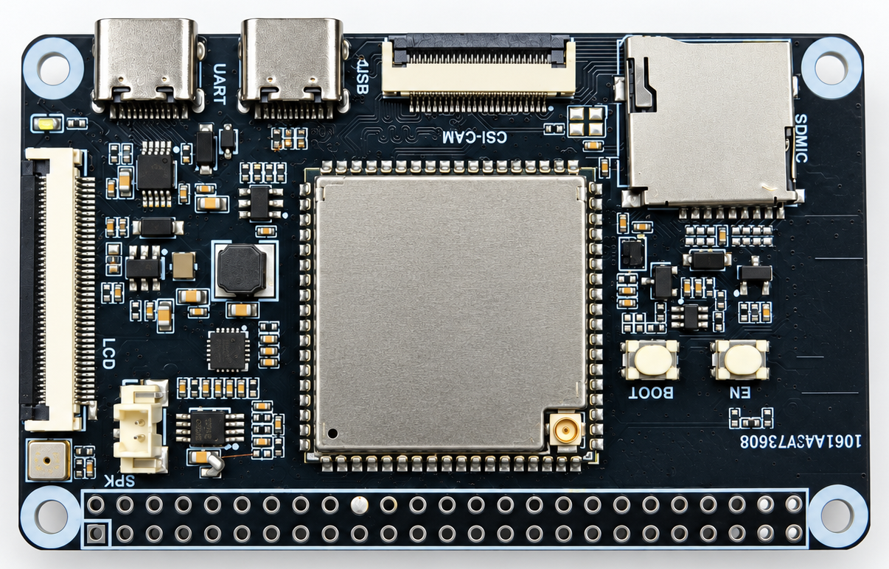

# ESP32-P4 DevKit v1.1 开发板介绍

原理图：[hardware/ESP32-P4_DevKit_v1.1.pdf](../hardware/ESP32-P4_DevKit_v1.1.pdf)

## 板载资源

| 功能 | 器件 / 说明 | 对应例程 |
| --- | --- | --- |
| 主控 | ESPP4-A 模组 | — |
| WiFi / BLE | 模组内置，板载天线 | [wifi_cmd](../components/p4_wireless/examples/wifi_cmd/)、[blufi](../components/p4_wireless/examples/blufi/) |
| 显示屏 | 4.96 寸 480×854，ST7102（显示和触摸同一颗芯片），MIPI-DSI 2-lane，40P 接口 | [lcd_lvgl](../examples/lcd_lvgl/) |
| 触摸 | 与屏一体，I2C 地址 0x55 | [lcd_lvgl](../examples/lcd_lvgl/) |
| 摄像头 | GC4023，MIPI-CSI 2-lane，24P 接口 | [camera](../examples/camera/) |
| 音频 | ES8311 编解码 + NS4150 功放（常开，喇叭接口）+ 板载模拟麦克风 | [audio](../examples/audio/) |
| TF 卡 | SDMMC Slot 0，4 线，带卡检测和电源开关 | [sdcard](../examples/sdcard/) |
| 调试串口 | Type-C（UART-DEBUG），CH340X，接 UART0（GPIO37/38），烧录和看日志都用这个口 | — |
| USB | Type-C（USB-OTG），接模组 USB_P / USB_N | [usb_msc](../examples/usb_msc/) |
| 按键 | BOOT（GPIO35）、RST（EN） | — |
| 指示灯 | 绿色电源灯 | — |
| 排针 | 2×25 排针引出 GPIO；2P 排针 5 V 输入 | — |

供电：任一 Type-C 口或 5 V 排针输入，板载 DC-DC 转 3.3 V。

## GPIO 分配

| GPIO | 功能 | 说明 |
| ---: | --- | --- |
| 4 | TF 卡电源开关 | 低电平给卡上电 |
| 9 / 10 | 摄像头 I2C SDA / SCL | GC4023 地址 0x29 |
| 11 | 摄像头复位 | 高电平释放复位 |
| 21 | 摄像头 MCLK | 由 P4 输出 24 MHz |
| 24 | 屏幕背光使能 | 高电平点亮 |
| 25 / 28 | ES8311 I2C SCL / SDA | 地址 0x18 |
| 26 / 27 / 30 | I2S MCLK / BCLK / LRCK | |
| 31 / 29 | I2S DOUT（→ES8311 DSDIN）/ DIN（←ES8311 ASDOUT） | |
| 35 | BOOT 键 | |
| 37 / 38 | UART0 TXD / RXD | 接 CH340X |
| 39 ~ 42 | TF 卡 D0 ~ D3 | |
| 43 / 44 | TF 卡 CLK / CMD | |
| 45 | TF 卡检测 | |
| 46 | 屏幕复位 | |
| 47 | 触摸复位 | 上电拉高后保持 |
| 48 / 49 | 触摸 I2C SCL / SDA | |
| 50 | 触摸中断 | 例程未使用（轮询） |

未被板载外设占用、可自由使用的 GPIO：0 ~ 3、5 ~ 8、12、13、20、22、23、32 ~ 34、36、51 ~ 53。
其中 GPIO34、36 是 strapping 引脚，见 [模组介绍](01_模组介绍.md#使用注意)。

以上外设的初始化参数（引脚、屏幕时序等）都已写在板级定义
[espp4_a_boards](../components/espp4_a_boards/) 里，例程直接使用即可。
